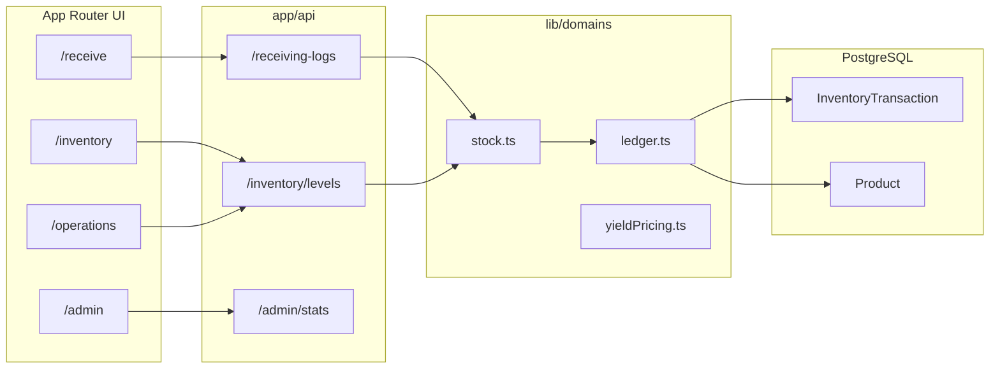

# FreshLoop AI — Developer guide

Technical overview for engineers working in this repo: architecture, data model, API surface, domain modules, and where legacy demo code still appears.

---

## Product intent (one paragraph)

FreshLoop is a **monolithic Next.js App Router** app for independent grocers. The **canonical source of truth** for floor stock and waste KPIs is the **Prisma `InventoryTransaction` ledger** (`lib/domains/inventory/ledger.ts`, `stock.ts`). UI routes under `app/` call **Route Handlers** in `app/api/*`, which delegate to **`lib/domains/*`**. Some screens (notably parts of **OperationsCenter**) still blend **live ledger data** with **`lib/legacy/mockData`** demo rows when the DB is empty or for UX prototypes.

---

## Stack

| Layer | Choice |
|-------|--------|
| Runtime | Node.js, Next.js **16.x** App Router |
| UI | React **19**, Tailwind **4**, Lucide, Recharts |
| DB | PostgreSQL (often Supabase), **Prisma 6** |
| AI | `@google/generative-ai` / `@google/genai`, Gemini for OCR, voice, recipe fusion |
| Auth | **Auth.js v5** (`next-auth@beta`) + **Credentials** + **JWT** sessions; `RoleProvider` wraps `SessionProvider` / `useSession()`. |

```bash
npm install
cp .env.example .env.local   # see .env.example for full list
npx prisma migrate deploy    # or: npx prisma migrate dev
npm run db:seed              # demo staff + products (password: freshloop)
npm run dev                  # http://localhost:3000 → /login if unsigned
npm run build                # prisma generate + next build
```

**Production deploy:** [DEPLOYMENT.md](./DEPLOYMENT.md) — Supabase pooler URLs, Vercel env vars, GitHub CI/migrate workflows, `npm run db:push:prod`, `GET /api/health`.

**Env helpers:** `lib/env/server.ts` (`getAuthOrigin`, `getPublicSiteUrl`, `getAuthSecret`).

### Authentication (Phase 1)

| Piece | Location |
|-------|----------|
| Auth config | `auth.ts`, `auth.config.ts` (edge-safe JWT callbacks) |
| Handlers | `app/api/auth/[...nextauth]/route.ts` |
| Staff signup | `app/signup/page.tsx`, `POST /api/auth/signup` |
| Forgot password | `app/forgot-password/page.tsx`, `POST /api/auth/forgot-password`, `POST /api/auth/reset-password` |
| Session helpers | `lib/auth/session.ts` — `getSessionUser()`, `requireSessionUser()`, `requireRoles()` |
| Route guards (API) | `lib/auth/guardRoute.ts` — manager / receiving / kitchen helpers |
| Middleware RBAC | `middleware.ts` + `canVisit()` in `lib/utils/roles.ts` |

**Environment**

- `AUTH_SECRET` — required (e.g. `openssl rand -base64 32`)
- `ALLOW_PUBLIC_SIGNUP=false` — disable self-service `/signup`

**Demo logins** (after seed): `admin@freshloop.test`, `manager@freshloop.test`, `floor@freshloop.test`, etc. Password **`freshloop`**.

**Employee profile:** `staff_users.email` is the unique work-email login. `hourly_rate_per_hour` is loaded into the JWT session (`session.user.hourlyRate`) and used by `POST /api/manufacturing` labor costing (`resolveExecutionLaborRate`). Managers may set wage via `PATCH /api/users/[id]` with `{ hourlyRate }`.

**RBAC (pages)**

| Routes | Roles |
|--------|--------|
| `/admin/users`, `/orders`, `/operations` | `ADMIN`, `STORE_MANAGER` |
| `/receive` | + `RECEIVING_CLERK` |
| `/kitchen` | + `DELI_CHEF` |
| `/inventory/floor` | all operational roles |
| `/admin` (profile) | any signed-in staff |

**API writes** must use `await requireSessionUser()` (or role helpers)—never trust `staffId` / `role` from the JSON body. Middleware returns **401** for unsigned `/api/*` except `/api/auth/*`, `/api/health`, and `/api/pos/webhook` (Bearer `POS_WEBHOOK_SECRET`, required).

### Input validation & API hardening

| Piece | Location |
|-------|----------|
| Zod schemas (strict `.strict()` bodies) | `lib/security/schemas/*` |
| JSON parse helper | `lib/security/parseJsonBody.ts` |
| Plain-text sanitization | `lib/security/sanitize.ts` |
| Mutation rate limits (per user / IP) | `lib/security/rateLimit.ts` |
| Safe API errors (no Prisma/stack leaks) | `lib/domains/ai/apiError.ts` → `apiErrorFromUnknown()`, `handleApiRouteError()` |
| Client error text from JSON | `lib/api/readApiError.ts` |

Use `parseJsonBody(req, schema)` on mutating handlers. In `catch`, prefer `return handleApiRouteError('POST /api/…', error, 'User-friendly fallback.')` so the server logs the full error and the client gets `{ success: false, error, message }` only. Hot paths call `assertMutationRateLimit`. UI mutations should use `try/finally` to clear loading state and surface `error` / `message` from the API.

**Secrets:** keep `AUTH_SECRET`, `DATABASE_URL`, `POS_WEBHOOK_SECRET`, `GEMINI_API_KEY`, `RESEND_API_KEY`, and Supabase service keys **server-only** (no `NEXT_PUBLIC_` prefix). See `.env.example`.

---

## Repository layout

```
app/                    # Routes only (pages + app/api route.ts)
components/
  ui/                   # Design system (Card, Button, Input, Toast, …)
  layout/               # AppShell, Navigation, PageIntro
  auth/                 # RoleProvider
  features/<domain>/    # Feature UI grouped by business area
lib/
  domains/              # Business logic (prefer importing from here)
  legacy/               # mockData, in-memory fallbacks, old db helper
  utils/                # roles, cn, units
types/                  # Shared TS types (@/types, re-export @/lib/types)
prisma/                 # schema, migrations, seed
docs/                   # PROJECT_STRUCTURE, manager/executive docs, this file
```

**Rule of thumb:** add behavior in `lib/domains/*`, keep `route.ts` thin (parse JSON → call domain → `NextResponse.json`). Add UI in `components/features/<area>/`.

**Admin stats:** use `getAdminStoreStatsBundle()` so waste % comes only from `calculateRealTimeWastePct()` (default **30-day** lookback via `DEFAULT_KPI_LOOKBACK_DAYS` in `wasteKpi.ts`). Prisma client: `@/lib/db/prisma`.

**Historical sales:** new `Sale` and `POS_Sale` rows store `realizedUnitPrice` and `realizedLineRevenue`. The waste denominator sums that recorded line revenue only. Rows with a null revenue are legacy and are left out of the ratio (current shelf price and `Unit_Cost_At_Time` are not substitutes). One bundle component may also store the full bundle total in `extendedRevenue`; that header amount is not added on top of the line shares. Physical waste stays at `unitCostAtTime`. Markdown loss stays on `markdown_events.revenue_impact`.

**Release order:** Vercel builds `main` automatically. The production migration workflow is manual (`workflow_dispatch` only) and does not run on merge. Apply `prisma/migrations/20261108191500_sale_realized_revenue` (nullable columns, no backfill) and confirm `\d "Inventory_Transactions"` shows `realized_unit_price` and `realized_line_revenue` before merging a build that selects them. Do not treat a missing Actions run as proof the migration is absent or applied; check `_prisma_migrations` or the columns on the target database. This repository does not auto-run that check.

See also [PROJECT_STRUCTURE.md](./PROJECT_STRUCTURE.md).

---

## App routes (pages)

| Path | Entry | Notes |
|------|--------|------|
| `/` | redirect | → `/admin` |
| `/admin` | `app/admin/page.tsx` | Dashboard, charts, case board |
| `/admin/users` | user CRUD UI | Backed by `/api/users` |
| `/receive` | ReceiveScreen | YieldPricingDashboard, dispositions |
| `/inventory` | SlateInventory + master-detail | PATCH/GET via `/api/inventory/levels` |
| `/inventory/floor` | FloorTransferPage | Clerk-focused transfers |
| `/operations` | OperationsCenter | KPI + demo ledger + OperationsLiveTransfers |
| `/kitchen` | Recipe fusion hub | `/api/recipe-fusion`, KitchenSubInventoryPanel |
| `/orders` | BuyList | Par/low stock from levels API |
| `/dashboard`, `/floor`, `/recipes`, `/rescue` | Legacy/alternate entry points | Check before linking in nav |

Most pages use **`AppShell`** + **`Navigation`** (role-filtered items in `components/layout/Navigation.tsx`).

---

## HTTP API reference

All handlers use `export const dynamic = 'force-dynamic'` unless noted. Errors often go through `lib/domains/ai/apiError.ts` (`apiError`, `apiErrorFromUnknown`).

### Inventory (ledger-backed)

| Method | Path | Purpose |
|--------|------|---------|
| `GET` | `/api/inventory/levels` | `getStockLevels()` → `{ success, levels, parCases, lowCount, orderCost }` |
| `PATCH` | `/api/inventory/levels` | `parCases`, `supplier`, case/yield/price fields, `casesOnHand` (manager role in body), or `action`: `rescue` \| `waste` \| `markdown` |
| `POST` | `/api/inventory/move` | `productId`, `action`: `rescue` \| `waste` \| `kitchen_waste` \| `markdown`, optional `quantity`, `staffId` |
| `GET` | `/api/inventory/on-hand` | Query on-hand for product(s) |
| `GET`/`PATCH` | `/api/inventory` | Broader inventory reads/updates (see `app/api/inventory/route.ts`) |
| `POST` | `/api/inventory/volumetric-scrap` | Bucket volume → waste transaction(s) |

**Client-side cache busting:** after successful moves/receives, UI dispatches `window` event **`freshloop-inventory-updated`**. Listeners refetch levels. Server-side: **`invalidateInventoryCaches()`** clears ledger read cache + store stats cache.

### Receiving

| Method | Path | Purpose |
|--------|------|---------|
| `GET` | `/api/receiving-logs` | `loadReceivingLogs()` — read-only Google Sheet. No sample rows. |
| `POST` | `/api/receiving-logs` | Save one delivery UUID → `postReceipt()`. Same UUID and payload is a no-op. A different payload is 409. |
| `POST` | `/api/receiving-invoices/identity` | Assign or reuse supplier, number, and exact-date line UUIDs. Conflicts do not post. |
| `POST` | `/api/receiving-invoices/reconcile` | Record a confirmed date, spelling, missing-line, rename, or legacy-receipt decision. |
| `GET` | `/api/receiving-dispositions` | Pending vendor credits |
| `POST` | `/api/receiving-dispositions` | Create disposition (not received / removed) |
| `PATCH` | `/api/receiving-dispositions/[id]` | Resolve credit |

**Receive UI session keys:** `freshloop-posted-receiving`, `freshloop-receiving-hidden` (optimistic hide before refetch).

**Delivery identity.** The sheet is read-only (`GOOGLE_SHEETS_API_KEY` values GET). FreshLoop does not write a UUID back. Add a column named `Delivery ID`, `Line ID`, or `External ID`. Generate the UUID once per delivery and leave that cell with the row when it is sorted or reused. A new delivery needs a new UUID even when the item and cost match. Rows without a UUID, and every row that repeats a UUID, are shown with `canPost: false`. `sheet-row-N` is rejected with 409 and does not delete old `recv:sheet-row-N` ledger keys.

Numbered invoices are identified by a saved `suppliers.id`, the invoice number, and the exact invoice date. Punctuation and internal spaces stay, so `1001/A`, `1001-A`, `A 12`, and `A12` are different until someone confirms otherwise. The printed vendor name is not a supplier id. A missing date, a different date, or a spacing collision returns 409 and does not post. `POST /api/receiving-invoices/reconcile` records the choice. A receiving clerk can add missing lines or open a separate document. Linking a date, linking a spelling, mapping a renamed line, and adopting an older receipt require a store manager or the owner. An older `invoice:vendor:number` key matches only when the vendor text is exactly the selected supplier's name. Lines added after that adoption still post stock. Year-first dates normalize to `YYYY-MM-DD`; impossible days and month-first dates are rejected. The server assigns each printed line a UUID once (`supplier_invoice_lines`). A rescan reuses that UUID when the printed text aligns, including when the catalog match appears, disappears, or changes. A changed product, quantity, case cost, or pack on that same UUID is 409 and does not create another receipt. A scan that only adds missing printed lines waits for confirmation before those lines are saved. A renamed line is not appended as a new receipt; it has to be mapped onto the saved line UUID. That exact supplier key blocks a new post until a manager adopts it, and the ledger key is left in place. The receiving board (`POST /api/receiving-invoices/identity`, then `POST /api/receiving-logs`) and direct OCR commit (`commitInvoiceOcrReceipts`) both use that registry. A blank invoice number or a missing saved supplier stays unposted. Old browser stashes whose ids start with `scan-` return 409 with `LEGACY_SCAN_STASH_ERROR`. Shelf price is not part of the physical receipt fingerprint.

Apply `20261108220000_receiving_delivery_uuid`, then `20261108223000_supplier_invoice_identity`, then `20261108233000_supplier_invoice_reconciliation`, then `20261108234000_supplier_invoice_line_legacy_hold` manually after review. Pushing this branch does not migrate production. No two migration folders on this branch share a timestamp. `20261028000000_recipe_labor_packaging` and `20261028000001_recipe_schema_align` are sequential recipe migrations. There is no manufacturing migration in this order. PR 65 must use this same supplier id, exact date, punctuation-and-space-preserving invoice number, and stored line UUID. It must not key receipts on vendor name, a whitespace-stripped number, a product match, or a row index.

Bridge from invoice OCR: `lib/domains/receiving/receivingBridge.ts` (`receivingLogsFromInvoice`, `consumeStashedReceivingScan`).

### Admin & users

| Method | Path | Purpose |
|--------|------|---------|
| `GET` | `/api/admin/stats` | Store stats / KPI aggregates |
| `GET`/`PATCH` | `/api/admin/settings` | `StoreSetting` row (waste target, pull days, scrap bucket params) |
| `GET`/`POST` | `/api/users` | Staff list / create |
| `PATCH` | `/api/users/[id]` | Update user |

### AI & manufacturing

| Method | Path | Purpose |
|--------|------|---------|
| `POST` | `/api/invoice-ocr` | Multipart image → Gemini → `InvoiceOcrResult` |
| `POST` | `/api/voice-logger` | Audio/text → parsed transfer + `TargetAction` |
| `GET`/`POST` | `/api/recipe-fusion` | List / generate fusion recipes (DB + legacy memory) |
| `POST` | `/api/manufacturing` | BOM execution / production batch (see route for payload) |
| `GET` | `/api/admin/markdown-suggestions` | Short-dated floor SKUs + suggested discount % |
| `POST` | `/api/pos/webhook` | Batch POS sales. Requires `Authorization: Bearer $POS_WEBHOOK_SECRET` and `externalRef` (idempotent). Body `staffId` is ignored. |

Gemini helpers: `lib/domains/ai/gemini.ts`.

**Invoice OCR commit:** `confirmCommit` payloads use `quantity_kind`: `'units'` (default) or `'cases'`. A case line's `unit_cost` is the case price and is stored per retail unit. The invoice header, lines, and lot receipts commit in one transaction. Optional `invoiceMeta` creates `VendorInvoice` + line items via `commitInvoiceOcrReceipts`.

---

## Domain modules

### `lib/domains/inventory/`

| Module | Responsibility |
|--------|----------------|
| `ledger.ts` | Prisma singleton, `InventoryLedgerError`, receive/sale/rescue/waste/bundle explosion, `getCurrentStock`, volumetric scrap refs |
| `stock.ts` | **`StockLevel`** DTO, `getStockLevels`, `postReceipt`, `moveRetailStock`, markdown, par/supplier/case updates, product name matching |
| `inventoryCache.ts` | `invalidateInventoryCaches()` |
| `ledgerCache.ts` | Memoized ledger reads (invalidate on writes) |
| `parLevel.ts` | Default par cases, order quantity math |
| `productMarkdownColumn.ts` | Markdown price column on product (schema evolution helper) |
| `subInventoryView.ts` | View-model helpers for sub-inventory UI |
| `inventoryMoveClient.ts` | Browser fetch wrapper for moves |

**Locations** (enum `InventoryLocation`): e.g. `Receiving`, `Main_Storage`, `Retail_Floor`, `Kitchen_Prep`, `Waste_Bin`, `Customer_Out`, …

**Transaction types:** `Receive`, `Sale`, `Rescue`, `Waste`, `POS_Sale`.

### `lib/domains/receiving/`

| Module | Responsibility |
|--------|----------------|
| `yieldPricing.ts` | Yield quote, margin modes, `ReceivingLog` types, formatting |
| `receivingSheet.ts` | Google Sheets loader + sample fallback |
| `receivingDisposition.ts` | CRUD for `ReceivingDisposition` |
| `receivingBridge.ts` | Invoice → receiving logs, session stash |

### `lib/domains/stats/`

| Module | Responsibility |
|--------|----------------|
| `wasteKpi.ts` | Waste % computations used by ledger/admin |
| `storeStats.ts` | Cached aggregates for admin dashboard |
| `platformSettings.ts` | Settings access |

### `lib/domains/ai/`

| Module | Responsibility |
|--------|----------------|
| `gemini.ts` | Model calls, shared prompts |
| `apiError.ts` | Consistent JSON error responses |

---

## Data model (Prisma)

File: `prisma/schema.prisma`.

**Core ledger path**

- **`Product`** — catalog SKU (department, unit, par, yield, prices, supplier).
- **`InventoryTransaction`** — immutable movement rows (qty, type, from/to, unit cost, staff, expiration).

**Operations & AI**

- **`StoreSetting`** — store-wide knobs (waste target %, pull sensitivity, scrap bucket economics).
- **`User`** — staff + `Role` enum.
- **`Recipe`** + **`RecipeBOM`** — manufacturing BOM (output product + ingredient lines).
- **`RecipeFusion`** — AI suggestion records (`ingredientsUsed` JSON, margin, instructions).
- **`ReceivingDisposition`** — lines removed from receive board (`NOT_RECEIVED` → vendor credit workflow).
- **`VendorInvoice`** / **`InvoiceLineItem`** — OCR persistence.
- **`InventoryItem`** — legacy/rich item row (status enum, pull thresholds); bridged to `Product` where linked.
- **`VoiceLog`**, **`Bundle`**, **`POSMapping`** — voice audit, bundles, future POS mapping.

**Queries the schema supports**

1. **Aging** — `expirationDate` on transactions/items; `receivedDate`; time-indexed transaction history.
2. **Revenue at risk** — derived from `Product.retailPrice` / markdown fields vs. `unitCostAtTime` on waste transactions (not a single DB column).
3. **Recipe consumption** — `RecipeBOM.quantityRequired` + `Recipe.yieldPortions`; fusion via `RecipeFusion.ingredientsUsed` JSON.

Run migrations after schema changes:

```bash
npx prisma migrate dev --name your_change
npx prisma generate
```

---

## Frontend patterns

### Role context

`components/auth/RoleProvider.tsx` wraps **Auth.js** (`useSession`). The signed-in user id and role come from the JWT session — not a browser “acting as” switcher.

- Managers can load the staff directory via `GET /api/users`.
- **`middleware.ts`** returns **401** for unsigned `/api/*` (except `/api/auth/*` and `/api/health`).
- Route handlers must call `requireSessionUser()` / `requireRoles()` — never trust `staffId` or `role` from JSON bodies.

### Imports

- Prefer `@/lib/domains/...`, `@/components/features/...`, `@/types`.
- Shims: `@/lib/types`, `@/lib/yieldPricing`, `components/features/receive/Fields` (re-exports for old paths).

### UI kit

Slate & Ocean Steel: `components/ui/*`, `lib/utils/cn.ts`, chart colors in admin charts.

### Next.js 16

See repo `AGENTS.md` — this Next version may differ from older docs; check `node_modules/next/dist/docs/` when unsure.

---

## Legacy vs live (important)

| Live (Prisma ledger + lots) | Legacy / demo |
|-----------------------------|----------------|
| `/api/inventory/levels`, `/move`, receive POST → `postReceipt` / `postProductReceipt` | `lib/legacy/mockData.ts` (avoid for new features) |
| `InventoryLot` FIFO + `MarkdownEvent` audit | `lib/legacy/db.ts` in-memory helpers (deprecated) |
| Recipe fusion → `RecipeFusion` table | — |
| Voice / invoice catalog matching | `loadProductCatalog()` → `Product` rows only |

When extending features, **wire new UI to domain functions** that write `InventoryTransaction`. Avoid adding new dependencies on in-memory stores.

---

## Extending the system

### Add a new inventory movement

1. Add or reuse `TransactionType` / locations in schema if needed (migration).
2. Implement writer in `ledger.ts` (single transaction boundary, call `invalidateInventoryCaches()`).
3. Expose via `stock.ts` helper and thin `app/api/.../route.ts`.
4. Dispatch `freshloop-inventory-updated` from client on success.

### Add a receiving side effect

1. Domain logic in `receivingDisposition.ts` or `stock.postReceipt`.
2. API route + optimistic UI in `YieldPricingDashboard` / `PackReceiptCard`.

### Add a page

1. `app/<route>/page.tsx` (server component unless hooks needed).
2. Feature component under `components/features/`.
3. Register nav in `Navigation.tsx` with `roles` array.

---

## Environment variables

Typical (names may vary; check `.env.local` in your deploy):

| Variable | Use |
|----------|-----|
| `DATABASE_URL` | Prisma pooled connection |
| `DIRECT_URL` | Prisma migrations / direct |
| `GEMINI_API_KEY` | OCR, voice, recipe fusion |
| Sheet / Google credentials | If configured in `receivingSheet.ts` (see implementation) |

---

## Testing & quality

- **Build gate:** `npm run build` (TypeScript + Next).
- **Lint:** `npm run lint`.
- No unified e2e suite in repo yet — smoke: `/receive`, `/inventory`, `/inventory/floor`, `/operations`, `/kitchen`, `/orders`, `/admin`.

---

## Related docs

| Doc | Audience |
|-----|----------|
| [FOR_STORE_MANAGERS.md](./FOR_STORE_MANAGERS.md) | Operations training |
| [EXECUTIVE_SUMMARY.md](./EXECUTIVE_SUMMARY.md) | One-page business summary |
| [PROJECT_STRUCTURE.md](./PROJECT_STRUCTURE.md) | Folder conventions |
| [README.md](../README.md) | Clone, install, feature list |

---

## Mental model diagram



This is the path new features should follow unless explicitly marked as demo-only.
